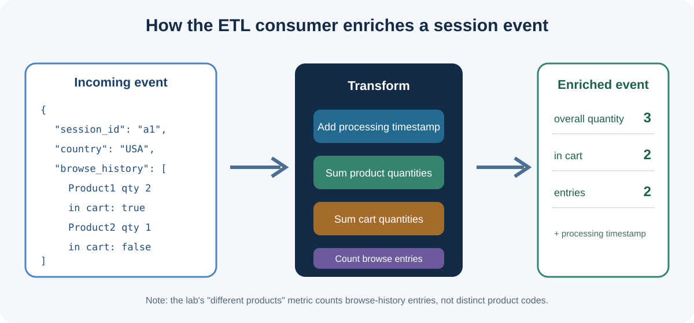

# AWS Kinesis Streaming Ingestion & ETL Pipeline

A practical data engineering project showing how customer activity events can move through a real-time AWS pipeline. I worked through two stages: first a simple producer/consumer pattern with Amazon Kinesis Data Streams, then a streaming ETL flow that enriches events, routes them by country, and delivers the results to Amazon S3 using Amazon Data Firehose.

The goal of this project was to understand the full journey of a record—from the moment a producer writes it, through shard-based consumption and transformation, to downstream storage.

## Architecture

### Part 1 — basic event streaming

A Python command-line producer sends JSON session events to a Kinesis Data Stream. A separate consumer reads records from the stream.


### Part 2 — streaming ETL and delivery

A Python ETL consumer reads the source stream, adds derived fields, and routes each record to either the USA or International destination stream. Each destination stream is connected to its own Data Firehose delivery stream and S3 bucket.


The record-level transformation is shown here:



## What the pipeline does

1. **Produce:** `src/cli/producer_from_cli.py` accepts a JSON event and writes it with Kinesis `PutRecord`. The session ID is used as the partition key.
2. **Consume:** `src/cli/consumer_from_cli.py` discovers stream shards, obtains `TRIM_HORIZON` iterators, and reads events with `GetRecords`.
3. **Transform:** `src/etl/consumer.py` adds `processing_timestamp` and calculates:
   - `overall_product_quantity`: sum of all quantities in `browse_history`.
   - `overall_in_shopping_cart`: sum of quantities where `in_shopping_cart` is true.
   - `total_different_products`: number of entries in `browse_history`. This is the list length, not a unique product-code count.
4. **Route:** events with `country == "USA"` go to the USA destination stream; all other events go to the International stream.
5. **Deliver:** Firehose delivers each destination stream's records to its corresponding S3 bucket.

## Repository structure

```text
.
├── data/
│   └── example_record.json
├── docs/
│   └── ARCHITECTURE.md
├── images/
│   ├── Part1.webp
│   ├── Part2.webp
│   ├── record-transformation.svg
│   ├── AWSLogout.webp
│   ├── CreateDataStream.webp
│   ├── TerminalsSwitch.webp
│   └── VSCodeCourseraTerminal.webp
├── notebooks/
│   ├── streaming-ingestion-walkthrough.ipynb
│   └── streaming-etl-walkthrough.ipynb
├── src/
│   ├── cli/
│   │   ├── producer_from_cli.py
│   │   └── consumer_from_cli.py
│   └── etl/
│       └── consumer.py
├── src_solution/
│   └── etl/
│       └── consumer.py
├── .gitignore
├── NOTICE.md
└── requirements.txt
```

## Evidence from the lab

The screenshots below show the workspace, stream setup, and terminal workflow used during the exercise.

- [Kinesis stream creation](images/CreateDataStream.webp)
- [Switching between producer and consumer terminals](images/TerminalsSwitch.webp)
- [VS Code terminal during the lab](images/VSCodeCourseraTerminal.webp)
- [AWS console session](images/AWSLogout.webp)

## Run locally

### Prerequisites

- Python 3.10 or newer.
- An AWS account with access to the Kinesis streams used in your environment.
- AWS credentials configured through an approved method, such as an AWS profile or role.

Never commit access keys, secret keys, session tokens, local AWS credential files, or account-specific configuration.

### Install dependencies

```bash
python -m venv .venv
# Windows:
.venv\Scripts\activate
# macOS/Linux:
source .venv/bin/activate

python -m pip install -r requirements.txt
```

### Start the consumer

```bash
python src/cli/consumer_from_cli.py --stream YOUR_SOURCE_STREAM_NAME
```

### Send a sample event

```bash
python src/cli/producer_from_cli.py --stream YOUR_SOURCE_STREAM_NAME --json_string '{"session_id":"a1","customer_number":100,"city":"Washington","country":"USA","credit_limit":1000,"browse_history":[{"product_code":"Product1","quantity":2,"in_shopping_cart":true},{"product_code":"Product2","quantity":1,"in_shopping_cart":false}]}'
```

### Run the streaming ETL consumer

```bash
python src/etl/consumer.py --source_stream YOUR_SOURCE_STREAM_NAME --dest_streams '{"USA":"YOUR_USA_STREAM","International":"YOUR_INTERNATIONAL_STREAM"}'
```

The destination streams should already exist and be connected to the relevant Data Firehose delivery streams and S3 buckets.

## What I learned

- How event producers, streams, shards, and consumers fit together.
- How partition keys and shard iterators affect Kinesis ingestion and reading.
- How to enrich each event as it arrives rather than waiting for a batch process.
- How a business rule can route records to different downstream systems.
- Where Firehose and S3 fit in the storage stage of a streaming architecture.

## What I would improve for production

This is a learning implementation, not a production-ready streaming platform. A real deployment should add durable consumer checkpoints, bounded retries with exponential backoff, idempotent writes, schema validation, malformed-record handling, a dead-letter path, metrics and alarms, encryption, least-privilege IAM policies, infrastructure as code, and automated tests.

## About the walkthrough notebooks

The notebooks in `notebooks/` are concise portfolio walkthroughs based on the lab. The reference implementation is kept separately in `src_solution/` so it is easy to distinguish from the main implementation. See [NOTICE.md](NOTICE.md) before redistributing any course-provided materials.

---

*This repository is a record of hands-on learning with AWS streaming ingestion and ETL, with the focus on understanding how data moves through the pipeline.*
