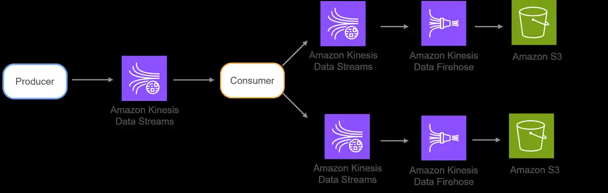
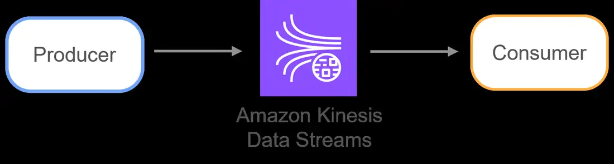
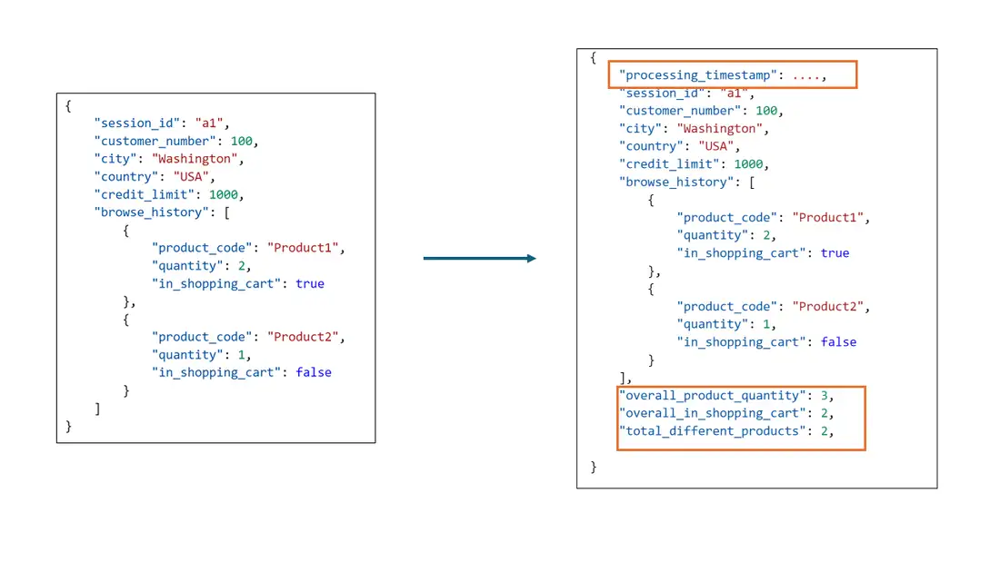
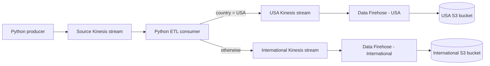

# AWS Kinesis Streaming Ingestion & ETL Pipeline

A hands-on streaming data engineering project built with **Amazon Kinesis Data Streams, Python, boto3, Amazon Data Firehose, and Amazon S3**.

The goal was to follow an event from the moment a Python producer publishes it, through a Kinesis stream, into a consumer that reads and enriches it, and finally into separate delivery paths for U.S. and international activity.



## Why this project matters

Batch pipelines are useful when data can wait. Event-streaming systems are useful when applications need to react to activity as it happens. In this lab I worked through both the basic producer–stream–consumer pattern and a small streaming ETL flow that transforms and routes user-session events.

I used Python and `boto3` to interact with AWS rather than treating the services as black boxes. That meant working with stream shards, shard iterators, sequence numbers, partition keys, record polling, and the permissions needed for services to pass data to one another.

## What I built

### 1. Basic event streaming



- A command-line **producer** accepts a JSON user-session event and publishes it with the Kinesis `PutRecord` API.
- The session ID is used as the **partition key**, keeping records for a session associated with the same shard-routing key.
- A command-line **consumer** discovers the stream's shards, obtains a `TRIM_HORIZON` iterator for each shard, and polls records with `GetRecords`.
- The consumer decodes each record, parses the JSON, and logs the session, shard ID, and sequence number.

The main scripts for this part are `src/cli/producer_from_cli.py` and `src/cli/consumer_from_cli.py`.

### 2. Streaming ETL and country-based routing

The second part extends the flow. A Python consumer reads a session from the source stream, adds processing information and summary metrics, and publishes the enriched event to one of two destination streams.



For each session, the ETL consumer:

1. Adds a `processing_timestamp` using the current Python datetime.
2. Calculates `overall_product_quantity` by summing the `quantity` value in every browse-history entry.
3. Calculates `overall_in_shopping_cart` by summing the quantity only for entries whose `in_shopping_cart` value is `true`.
4. Adds `total_different_products` using `len(browse_history)`. In this implementation that is the number of browse-history entries; it does not perform a distinct-product-code operation.
5. Routes the record to the **USA** stream when `country == "USA"`; all other country values go to the **International** stream.

The implementation is in `src/etl/consumer.py`. It serializes the datetime as an ISO-formatted string before sending the event to the destination stream.

### 3. Delivery to Amazon S3

Each destination Kinesis stream is configured as the source for its own Amazon Data Firehose delivery stream. Firehose is configured to deliver the transformed records to the corresponding S3 bucket.

This keeps the processing and delivery responsibilities separate:

- **Kinesis Data Streams** handles real-time event ingestion and stream consumption.
- **Python / boto3** performs the transformation and routing logic.
- **Amazon Data Firehose** handles managed delivery from the destination streams.
- **Amazon S3** provides durable object storage for the delivered data.

## Architecture at a glance



## Example transformation

The sample record in `data/example_record.json` contains two browse-history entries: quantities 2 and 1, with only the first entry in the shopping cart. The resulting metrics are therefore:

| Field | Result | How it is calculated |
|---|---:|---|
| `overall_product_quantity` | `3` | `2 + 1` |
| `overall_in_shopping_cart` | `2` | Only the quantity from the entry marked `true` |
| `total_different_products` | `2` | `len(browse_history)` |

The ETL event also includes `processing_timestamp`, generated when the consumer processes the record.

## Repository layout

```text
.
├── data/
│   └── example_record.json
├── docs/
│   └── ARCHITECTURE.md
├── images/
│   ├── evidence/                 # Sanitized screenshots from the lab run
│   ├── Part1.webp                 # Basic producer / stream / consumer diagram
│   ├── Part2.webp                 # Full streaming ETL architecture diagram
│   ├── Transformation.webp        # Transformation illustration
│   └── Transformation2.webp       # Transformation illustration with highlights
├── src/
│   ├── cli/
│   │   ├── producer_from_cli.py
│   │   └── consumer_from_cli.py
│   └── etl/
│       └── consumer.py
├── src_solution/
│   └── etl/consumer.py           # Reference copy retained from the lab bundle
├── C2_W2_Lab_1_Streaming_Ingestion.ipynb
├── C2_W2_Lab_1_Streaming_Ingestion_Solution.ipynb
├── requirements.txt
└── README.md
```

The two notebooks preserve the lab walkthrough and its reference notebook. The `src/` directory is the main implementation to review. `src_solution/` and the solution notebook are retained as reference material from the supplied lab files, not presented as a separate project authored from scratch.

## Run it yourself

### Prerequisites

- Python 3.9 or newer
- An AWS account with permission to use Kinesis Data Streams, Data Firehose, and S3
- AWS credentials configured locally through an AWS profile, AWS SSO, or environment-based credentials
- A Kinesis source stream; for the ETL part, two destination streams and the matching Firehose/S3 resources

**Do not put AWS access keys, secret keys, session tokens, account-specific credentials, or `.env` files in this repository.** Notebook execution outputs have been cleared from the public copies; the notebooks retain the code and walkthrough.

### Install dependencies

```bash
python -m venv .venv

# macOS / Linux
source .venv/bin/activate

# Windows PowerShell
# .venv\\Scripts\\Activate.ps1

python -m pip install --upgrade pip
pip install -r requirements.txt
```

### Part 1 — publish and consume an event

Open two terminals from the repository root. Replace `YOUR_SOURCE_STREAM` with the name of a Kinesis Data Stream you can access.

**Terminal A — start the consumer:**

```bash
python src/cli/consumer_from_cli.py --stream YOUR_SOURCE_STREAM
```

**Terminal B — publish the sample event:**

```bash
python src/cli/producer_from_cli.py \\
  --stream YOUR_SOURCE_STREAM \\
  --json_string '{"session_id":"session-001","customer_number":100,"city":"Washington","country":"USA","credit_limit":1000,"browse_history":[{"product_code":"Product1","quantity":2,"in_shopping_cart":true},{"product_code":"Product2","quantity":1,"in_shopping_cart":false}]}'
```

The producer logs the sequence number and shard returned by Kinesis. The consumer logs the event it reads. Both programs continue running until you stop them with `Ctrl+C`.

### Part 2 — run the streaming ETL consumer

After creating the source and destination streams and configuring the Firehose delivery streams and S3 buckets, run:

```bash
python src/etl/consumer.py \\
  --source_stream YOUR_SOURCE_STREAM \\
  --dest_streams '{"USA":"YOUR_USA_STREAM","International":"YOUR_INTERNATIONAL_STREAM"}'
```

The ETL consumer continuously polls the source stream, enriches each session, and sends it to the appropriate destination stream. You can use the CLI consumer from Part 1 to inspect records in either output stream.

The notebook contains the guided AWS setup steps and the resource configuration used for the exercise. Replace all example resource names with the names in your own account. The lab notebook uses `us-east-1` as its AWS region setting; change that value when working in another region.

## Evidence from my lab run

The screenshots below are included to make the work easier to review. Account-specific identifiers and lab-session identifiers have been obscured.

| Evidence | What it shows |
|---|---|
| [Producer and consumer terminal output](images/evidence/producer-consumer-terminal-output.webp) | The producer publishes several sample sessions and the consumer reads records from Kinesis shards. |
| [Active Kinesis streams](images/evidence/kinesis-streams-active.webp) | The AWS console showing the two data streams used during the exercise in an active state. |
| [Kinesis stream configuration](images/evidence/kinesis-stream-configuration.webp) | The stream details and the Kinesis console's producer / consumer integration options. This capture was taken while the stream was provisioning. |
| [S3 buckets](images/evidence/s3-buckets-created.webp) | The two destination buckets created for U.S. and international delivery. |
| [VS Code project layout](images/evidence/vscode-project-layout.webp) | The project folders and Python files used during the lab. |

The notebook also retains the Firehose creation steps with generic account placeholders; live account-specific execution output has been cleared from the published copies. The screenshots establish the stream and bucket setup and the producer/consumer test; they do not include a captured S3 object listing after delivery.

## What I learned

- How a producer, stream, and consumer fit together in an event-driven architecture.
- How Kinesis shards, partition keys, shard iterators, and sequence numbers appear in an actual workflow.
- How to read records with `GetRecords` and publish records with `PutRecord` using `boto3`.
- How to enrich an event in-flight with processing metadata and business metrics.
- How to route data based on an event attribute without mixing the routing logic into the producer.
- How Data Firehose and S3 fit into a downstream delivery path.
- Why AWS IAM roles and permissions matter when one managed service reads from another service and writes to storage.

## Notes before using this as a production pattern

This is a learning project, not a production-ready streaming service. A production implementation should add or review graceful shutdown, checkpointing and restart behaviour, iterator-expiration handling, bounded retries with backoff, structured metrics and alarms, schema validation, timezone-aware timestamps, and idempotency / duplicate-event handling. It should also validate Firehose delivery by checking the destination objects and delivery metrics.

The consumer scripts intentionally run in a polling loop for the lab. Stop them manually with `Ctrl+C` when testing is complete.

## Clean up AWS resources

Streaming resources and managed delivery services can incur charges while they exist. After your own test, review the resources created by the notebook and delete the lab-only Kinesis streams, Firehose delivery streams, S3 objects/buckets, and CloudWatch log groups when they are no longer needed. Empty S3 buckets before deleting them. Do not delete shared or pre-existing resources.

---

*Built as a practical learning exercise in real-time data ingestion and streaming ETL. The repository keeps the code, notebooks, diagrams, and sanitized run evidence together so another engineer can follow the flow from event creation to downstream storage.*
