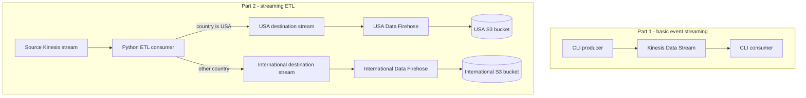

# Architecture and implementation notes

## Event flow

## Record lifecycle

1. The producer serializes a session object as JSON and calls `PutRecord`. The value of `session_id` is used as the partition key.
2. The consumer enumerates stream shards, asks Kinesis for a shard iterator using `TRIM_HORIZON`, and reads batches through `GetRecords`.
3. The ETL consumer parses the JSON body and adds a processing timestamp.
4. It iterates through `browse_history`, converting quantities to integers before calculating the total quantity and the quantity currently in shopping carts.
5. It adds `total_different_products` as the length of the browse-history list.
6. The record is sent to the U.S. destination stream only when `country` is exactly `USA`; otherwise it is sent to the international stream.
7. Each destination stream is attached to a Data Firehose delivery stream configured to write to its corresponding S3 bucket.

## Important implementation details

- The CLI consumer and ETL consumer use `TRIM_HORIZON`, so a newly acquired iterator starts at the oldest retained data available to that shard.
- The consumers keep the `NextShardIterator` returned by `GetRecords` and use it for the next polling cycle.
- The CLI consumer sleeps for one second between polling cycles; the ETL consumer sleeps for two seconds for lab visualization.
- `total_different_products` is calculated with `len(browse_history)`. It counts entries in the list, not unique product codes if duplicate codes appear.
- The ETL consumer serializes Python `datetime` values through `serialize_datetime()` before JSON encoding.
- The lab code is deliberately small and omits production concerns such as durable checkpoints, robust retry/backoff policies, and schema enforcement.