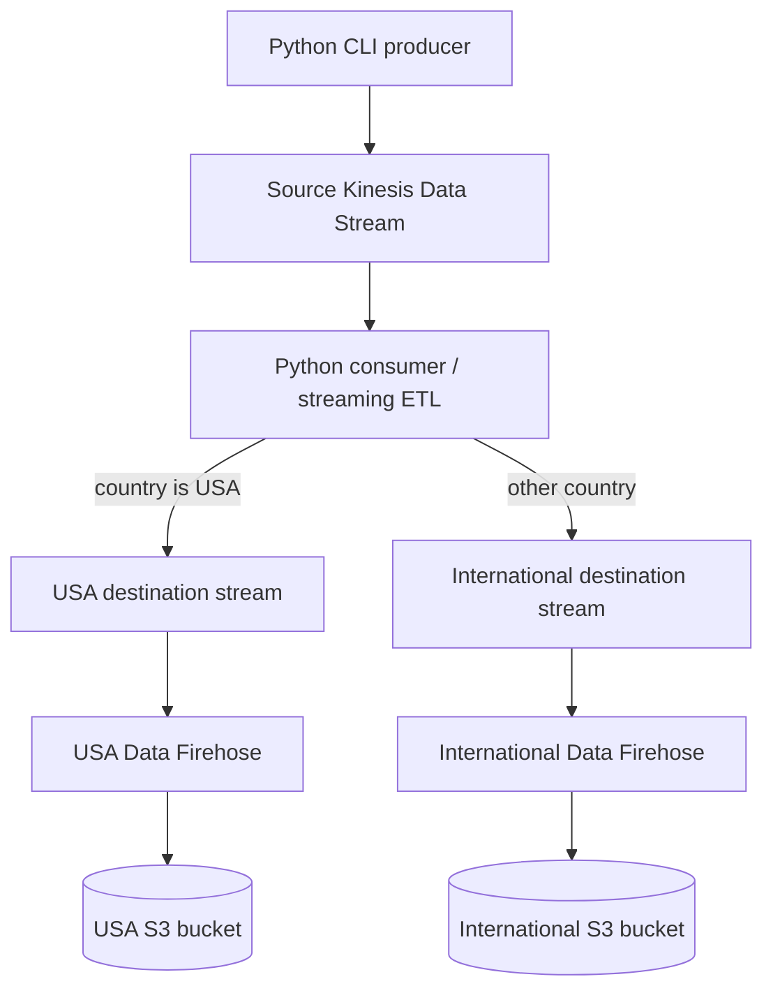

# Architecture and implementation notes

## End-to-end flow

## Record lifecycle

1. The producer serializes a session object as JSON and calls `PutRecord`. The value of `session_id` is used as the partition key.
2. The consumer enumerates stream shards, obtains iterators using `TRIM_HORIZON`, and reads batches through `GetRecords`.
3. The ETL consumer parses the JSON record and adds a processing timestamp.
4. It iterates through `browse_history`, converts quantities to integers, and calculates total quantity and shopping-cart quantity.
5. It adds `total_different_products` as the length of the browse-history list.
6. It sends the record to the USA destination stream only when `country` is exactly `USA`; otherwise it sends it to the International destination stream.
7. Each destination stream is connected to a Data Firehose delivery stream configured to write to its corresponding S3 bucket.

## Implementation details and trade-offs

- `TRIM_HORIZON` starts at the oldest retained data available to a shard. Restarting this way can replay older records.
- The consumers keep shard iterators in memory and do not save durable checkpoints.
- The CLI consumer sleeps for one second between polling cycles; the ETL consumer sleeps for two seconds for lab visualization.
- `total_different_products` counts browse-history entries, not unique product codes.
- Python datetime values are serialized as ISO-8601 strings before JSON encoding.
- The lab code does not implement a full retry, backoff, idempotency, or dead-letter strategy.

## Production considerations

A production version should add durable checkpoints, idempotent sinks, bounded retries with exponential backoff, schema validation, malformed-record handling, dead-letter storage, metrics and alarms, encryption, least-privilege IAM, infrastructure as code, and automated tests.
